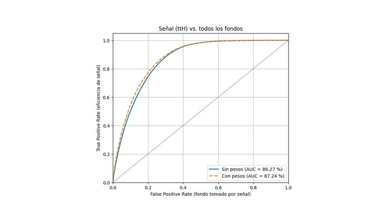
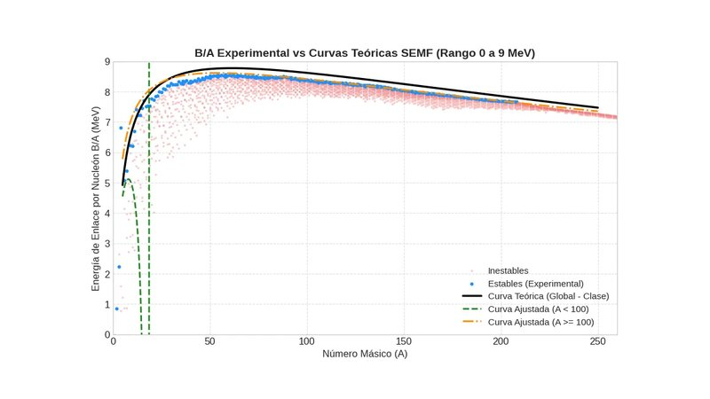
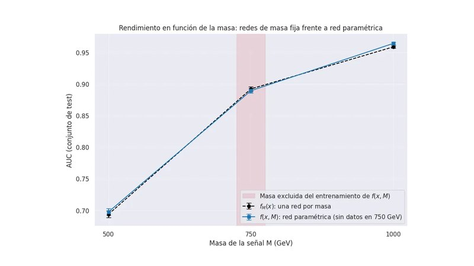
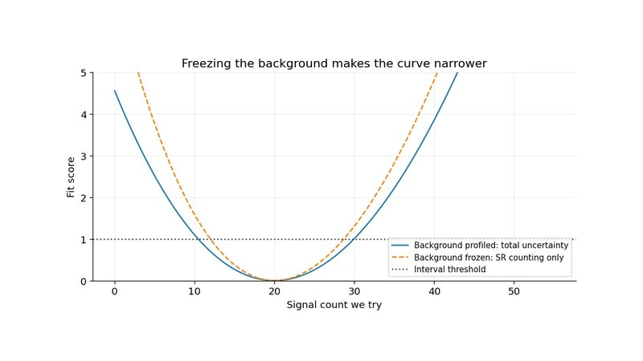
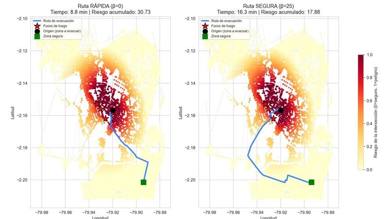
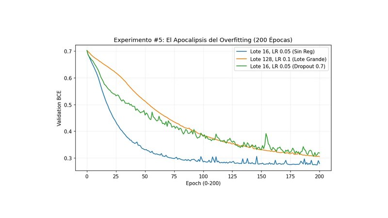
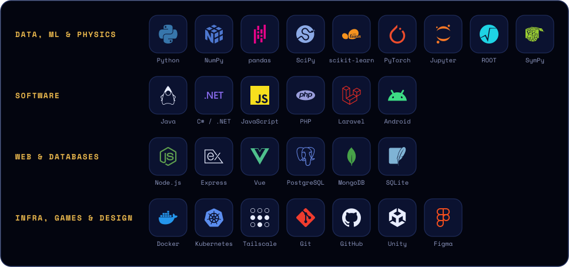

  

  &nbsp;
  &nbsp;
  

## About me

I'm a Computer Engineering student at **Universidad de Especialidades Espíritu Santo (UEES)** in Guayaquil, Ecuador, currently on an exchange semester at the **Universidad de Oviedo** in Spain, where I'm taking Data Analysis in Modern Physics, Nuclear and Particle Physics, and Intelligent Systems.

What pulls me in is the data behind science. A particle collider records millions of collisions, and almost all of them are background: finding the few that matter is as much a problem of statistics and machine learning as it is of physics. That is the kind of work I enjoy most, taking real scientific data, understanding where it comes from, and building models I can explain, not just train. My courses in Oviedo let me do exactly that with particle-physics data, and it's the direction I want to keep growing in.

- **3rd place**, WiDS Datathon 2026 (ESPOL): wildfire evacuation routes for Guayaquil
- **Dean's List** at UEES, overall GPA 95.46/100
- **Teaching assistant** for five semesters: Physics I and Mathematics I–III
- **IT intern** in IT audit at Grant Thornton Ecuador

## Featured projects

<table>
  <tr>
    <td width="50%" valign="top">
      
       <b>Hunting the Higgs boson (ttH) with PyTorch</b>
       Neural networks that separate Higgs-boson signal from background in collision data, then predict the Higgs pT.
       <a href="https://github.com/DanielV-13/ADFM---PA_03_neural_network_torch.ipynb">Code</a> ·  · PyTorch, uproot (ROOT), scikit-learn
    </td>
    <td width="50%" valign="top">
      
       <b>Liquid drop model: fitting the nuclear binding energy</b>
       Least-squares fit of the semi-empirical mass formula to real nuclear data, with the chart of nuclides and the neutron drip line.
       <a href="https://github.com/DanielV-13/FNPE---CALCULO-DE-PARAMETROS-de-MODELO-DE-LA-GOTA-LIQUIDA-SEMF-">Code</a> ·  · NumPy, SciPy, pandas
    </td>
  </tr>
  <tr>
    <td width="50%" valign="top">
      
       <b>Parameterized neural networks for an X → tt̄ search</b>
       One network that takes the particle's mass as an input and still works on masses it never saw.
       <a href="https://github.com/DanielV-13/ADFM---PL_02_inductive_bias_parameterized_nns.ipynb">Code</a> ·  · PyTorch, scikit-learn
    </td>
    <td width="50%" valign="top">
      
       <b>Profile likelihood fits</b>
       How much signal is there, and how sure are we? A counting experiment done the particle-physics way, with a coverage study on toy experiments.
       <a href="https://github.com/DanielV-13/ADFM---PL_01_profile_likelihood_RESUELTO_Daniel_Vaca.ipynb">Code</a> ·  · iminuit (MINUIT), SciPy
    </td>
  </tr>
  <tr>
    <td width="50%" valign="top">
      
       <b>WiDS Datathon 2026 · 3rd place (Team Artemis-4)</b>
       Wildfire evacuation routes for Guayaquil, from satellite fire data, wind and the real street network.
       <a href="https://github.com/bypaupau/WIDS-DATATHON-2026-ARTEMIS4">Code</a> ·  · NetworkX, OSMnx, folium
    </td>
    <td width="50%" valign="top">
      
       <b>A neural network from scratch in NumPy</b>
       Every piece written by hand: matrices, activations, loss, derivatives and the training loop.
       <a href="https://github.com/DanielV-13/ADFM---PA_02_neural_network_from_scratch">Code</a> ·  · NumPy, pandas
    </td>
  </tr>
</table>

  More projects in software, data, systems, UX design and games on my <a href="https://danielv-13.github.io"><b>portfolio</b></a>.

## Tech stack

  

## Currently

- Exchange semester at the Universidad de Oviedo, Spain (Sep 2026 – Jan 2027)
- Applying machine learning and statistics to particle-physics data
- Publishing my physics and ML notebooks here, fully commented
